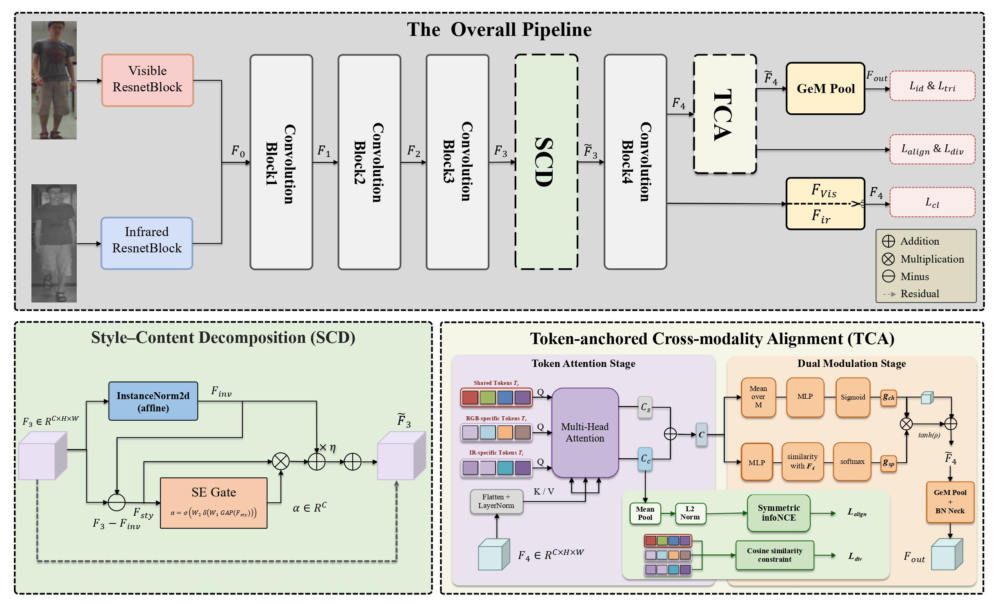

# SCTNet: Style-Content Decomposition and Token-anchored Cross-modality Alignment Network for Visible-Infrared Person Re-Identification

Official PyTorch implementation of the paper **"SCTNet: Style-Content Decomposition and Token-anchored Cross-modality Alignment Network for Visible-Infrared Person Re-Identification"**.



## Overview

We propose **SCTNet**, a framework for VI-ReID that explicitly decouples modality differences at the instance and semantic levels. Our method comprises two core modules:

- **SCD (Style-Content Decomposition):** Employs instance normalization to separate modality-specific style residuals (color/illumination for VIS, thermal radiation for IR) from modality-invariant content, and re-injects the content together with a gated copy of the style residual to re-balance the style-content composition in a channel-wise manner.
- **TCA (Token-anchored Cross-modality Alignment):** Adopts learnable query tokens shared by VIS/IR modalities as explicit semantic anchors, together with three groups of decoupled tokens and a symmetric InfoNCE loss to guide cross-modal feature aggregation.

## 1. Requirements

Our experiments are conducted under the following environments:

- Python 3.8.20
- Pytorch == 2.1.2
- torchvision == 0.16.2
- One NVIDIA A30 GPU

## 2. Datasets

- **RegDB** [1]: The RegDB dataset can be downloaded from this [website](https://github.com/githubXin89/RegDB-dataset).

- **SYSU-MM01** [2]: The SYSU-MM01 dataset can be downloaded from this [website](https://github.com/wuancong/SYSU-MM01).

  - run `python pre_process_sysu.py` to prepare the dataset, the training data will be stored in ".npy" format.

    ```
    python pre_process_sysu.py
    ```

- **LLCM** [4]: The LLCM dataset can be downloaded from this [website](https://github.com/ZYK100/LLCM).


## 3. Training

**Train SCTNet by**

```
python train.py --dataset sysu --gpu 0
```

- `--dataset`: which dataset "sysu", "regdb" or "llcm".

- `--gpu`: which gpu to run.

*You may need manually define the data path first.*


## 4. Testing

**Test a model on SYSU-MM01 dataset by**

```
python test.py --dataset 'sysu' --mode 'all' --resume 'model_path'  --gpu 0
```

  - `--dataset`: which dataset "sysu" or "regdb".
  - `--mode`: "all" or "indoor"  (only for sysu dataset).
  - `--resume`: the saved model path.
  - `--gpu`: which gpu to use.


**Test a model on RegDB dataset by**

```
python test.py --dataset 'regdb' --resume 'model_path'  --tvsearch --gpu 0
```

  - `--tvsearch`:  whether thermal to visible search (only for regdb dataset).


**Test a model on LLCM dataset by**

```
python test.py --dataset 'llcm' --resume 'model_path'  --gpu 0
```


## 5. Results

We adopt **ResNet-50** [3] as backbone with ImageNet pretrained weights.

| Datasets | Backbone | Rank@1 |  mAP  |
| :------: | :------: | :----: | :-----: |
|  SYSU-MM01   |   ResNet-50    | 82.78% | 77.61% |
|  RegDB   |   ResNet-50    | 95.44% | 92.32% |
|  LLCM   |   ResNet-50    | 68.58% | 70.29% |

**\*The results may exhibit fluctuations due to random splitting, and further improvement can be achieved by fine-tuning the hyperparameters.**


## 6. Citation

This project is built upon the [IRL](https://github.com/Mapzzone/2025-ACMMM-IRL) (Low-light Invariant Representation Learning) framework [3]. The code related to LLCM dataset is borrowed from [DEEN](https://github.com/ZYK100/LLCM) [4].

Thanks a lot for the authors' contribution.


##  References

[1] D. T. Nguyen, H. G. Hong, K. W. Kim, and K. R. Park. Person recognition system based on a combination of body images from visible light and thermal cameras. Sensors, 17(3):605, 2017.

[2] A. Wu, W.-s. Zheng, H.-X. Yu, S. Gong, and J. Lai. Rgb-infrared crossmodality person re-identification. In IEEE International Conference on Computer Vision (ICCV), pages 5380–5389, 2017.

[3] Wang D, Xing G, Liu Y. Low-light Invariant Representation Learning for Visible-Infrared Person Re-identification[C]//Proceedings of the 33rd ACM International Conference on Multimedia. 2025: 8645-8653.

[4] Zhang Y, Wang H. Diverse Embedding Expansion Network and Low-Light Cross-Modality Benchmark for Visible-Infrared Person Re-identification[C]//Proceedings of the IEEE/CVF Conference on Computer Vision and Pattern Recognition. 2023: 2153-2162.
